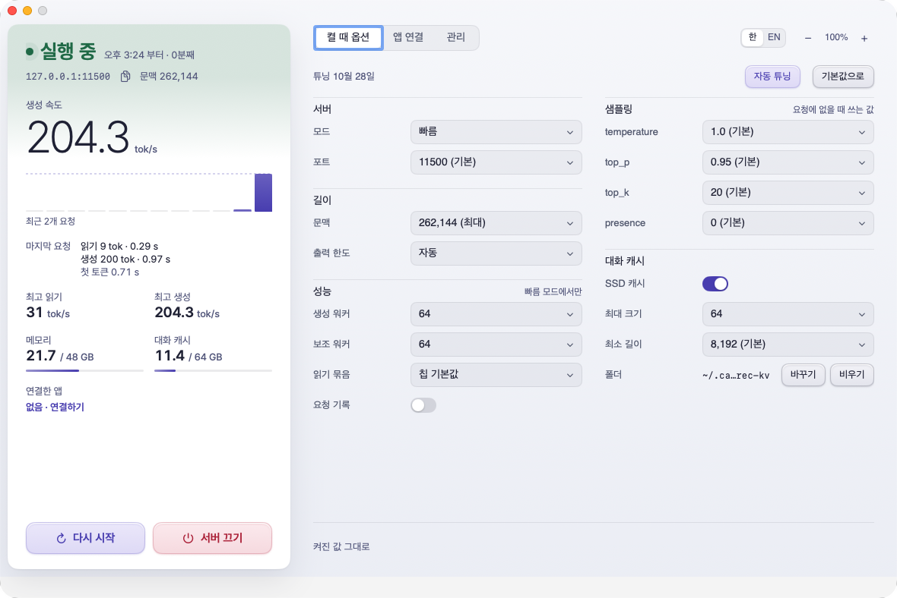
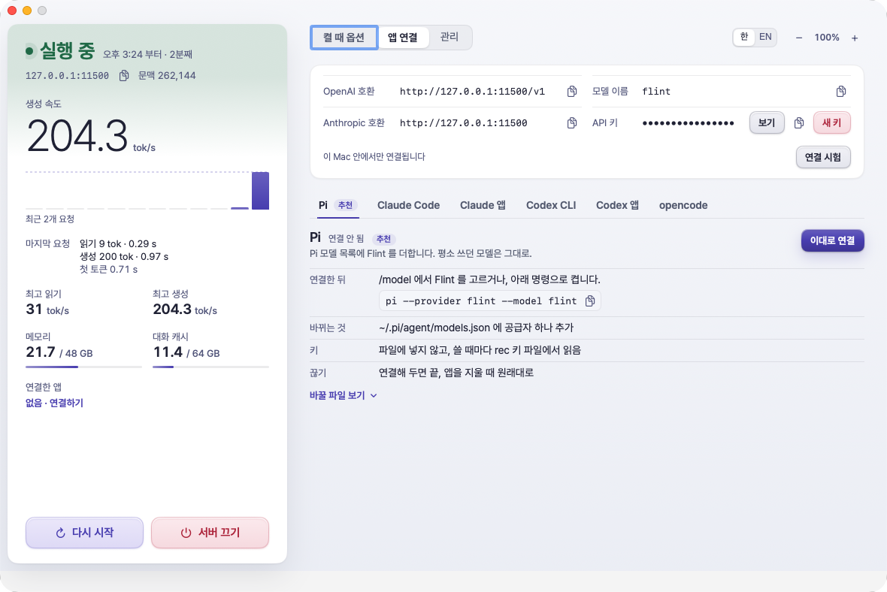

<p align="center"></p>

<h1 align="center">bable-flint</h1>

<p align="center"><b>The local coding model Flint, faster on your Mac.<br>Connected to the coding apps you already use, one button each.</b></p>

<p align="center">
  <a href="README.md">한국어</a> · <b>English</b> · <a href="README.ja.md">日本語</a>
</p>

<p align="center">
  
  
  
  
</p>

<p align="center"></p>

## At a glance

| | |
|---|---|
| ⚡ **Faster generation** | Against rec's original runtime: **+21%** at 32K context (107.2 → 129.7 tok/s), **+24%** at 64K (74.0 → 91.5 tok/s) |
| 📦 **Everything in one app** | The Flint engine (rec 0.1.1) ships inside the app. Nothing else to install, no versions to match |
| 🔌 **Six apps, one button each** | Pi, Claude Code, Codex CLI, Codex in the ChatGPT app, the Claude app, opencode |
| 💾 **SSD conversation cache** | Continuing a long conversation does not read the start again, even after a restart |
| 🎛 **Auto-tune** | Measures and finds the fastest worker counts and read chunk for this Mac |
| 🔒 **Stays on this Mac** | The server only accepts requests from 127.0.0.1. Conversations never leave the Mac |

<sub>Measured on an M4 Max (40-core GPU), 48 GB memory, macOS 27.2, flint-int4.</sub>

## Requirements

| | |
|---|---|
| Chip | Apple Silicon **M4 Pro, M4 Max, M5 Pro or M5 Max** |
| Memory | **48 GB** or more |
| Disk | **32 GB** free or more (21 GB model + engine + conversation cache). 10 GB if the model is already there |
| macOS | 15 or later |
| `python3` | Included with the Xcode Command Line Tools |
| Only for Codex in the ChatGPT app | Python 3.14 or later (for example Homebrew's `python3`) |

If your Mac falls short, the app shows what is missing and downloads or changes nothing.

## Install

1. Download `bable-flint-<version>.dmg` from [Releases](../../releases).
2. Open the dmg and drag `bable-flint` into the `Applications` folder.
3. The first time you open it, macOS blocks it as coming from an unverified developer (the app has no Apple developer signature).
   Go to **System Settings → Privacy & Security**, press **Open Anyway** at the bottom, then **Open** once more. After that it opens normally.
   If you prefer Terminal, this one line does the same:

   ```sh
   xattr -dr com.apple.quarantine /Applications/bable-flint.app
   ```

## First run

The app walks you through it.

| Step | What happens |
|---|---|
| 0 | It asks for the name of the YouTube channel that made the app. Type **`bable`** (any case). Once answered, it never asks again |
| 1 | It checks that this Mac meets the requirements |
| 2 | It puts the engine inside the app (rec 0.1.1) into the app's own folder, `~/.local/share/bable-flint`. Automatic |
| 3 | **Download** fetches the Flint model (about 21 GB). If a rec you installed yourself already downloaded it, the app clones that instead (an APFS clone, no extra space) |
| 4 | **Install** unpacks the engine's original runtime and lays the speed-up on a copy of it |

When it is done, press **Start server**.

> Already using rec on its own? That's fine. This app only uses the engine in its own folder and never reads or changes a rec you installed, whatever its version. Both use port 11500 by default, so run one at a time.

## Everyday use

- **Left panel**: server state, speed of the last request (tok/s), memory, conversation cache and connected apps, with **Start server**, **Restart** and **Stop server** below.
- **Tabs on the right**: **Options**, **Apps**, **Manage**.
- **Top right**: the **한/EN** language switch and zoom (−, 100%, +, or ⌘+ ⌘− ⌘0).
- Closing the window keeps the server running. The Dock icon hides and the flame icon stays in the menu bar.
- **Menu bar icon**: state and speed, start, stop and restart the server, open the window, copy the address, quit.
- Quitting while the server runs asks: **Quit, Keep Server On**, **Quit and Stop Server** or **Cancel**.

## Options

These are the values the server starts with. Changes take effect when the server restarts.

- **Mode**: Fast (the speed-up) or Standard (the engine's original runtime, about 20% slower)
- **Context, output limit, sampling**
- **Workers**: generation workers, helper workers, read chunk
- **SSD conversation cache**: folder and maximum size
- **Reset to defaults** puts the values back where they started

### Auto-tune

Restarts the server for each candidate value, measures the speed, and proposes the fastest workers and read chunk for this Mac.

- It takes 5 to 20 minutes. The server is unavailable meanwhile.
- It only proposes a change that is more than 3% faster than what you have. Values that change the answer to the same question are dropped.
- Apply the result right away or only put it into Options. Stopping it restarts the server with the previous values.
- Quitting the app during a run stops the run and the server. Next time the server starts with your own values.

## Connecting apps

<p align="center"></p>

In the **Apps** tab, each app shows what connecting will change. Press **Connect** to go ahead.

| App | Connecting | How to use it |
|---|---|---|
| **Pi** (recommended) | Adds one Flint provider to Pi's model list (`~/.pi/agent/models.json`). The key is not written into the file; Pi reads it from the key file each time | `/model` → Flint, or `pi --provider flint --model flint` |
| **Claude Code** | Your usual `claude` stays as it is; a separate `claude-flint` command is added, with its own skills, MCP servers and history | `claude-flint` |
| **Codex CLI** | Your usual `codex` stays as it is; a separate `codex-flint` command is added. Web search, sub-agents and image input do not work | `codex-flint` |
| **Codex in the ChatGPT app** | Adds **Flint (local)** at the bottom of the model list (one line in `~/.codex/config.toml`). A relay on this Mac sends only Flint requests to Flint; while connected, Codex's other requests also pass through it | Restart the ChatGPT app, then pick the model |
| **Claude app** | Switches the app to its third-party (3P) mode to use **Flint (local)**. While connected, your claude.ai sign-in and chats are hidden; they come back when you disconnect | Quit the Claude app with ⌘Q before connecting or disconnecting |
| **opencode** | Adds one provider to its settings | `/models` → Flint, or `opencode -m flint/flint` |

- **Disconnect** restores the earlier settings and moves the files Flint made to the Trash.
- Pi and opencode only gain a model to pick, so they have no disconnect button; uninstalling this app puts them back as they were.
- If Pi is not installed, the tab shows Pi's own install command (`curl -fsSL https://pi.dev/install.sh | sh`).

**Any other app** can be set up by hand. The same tab has everything it needs:

| | |
|---|---|
| OpenAI-compatible address | `http://127.0.0.1:11500/v1` |
| Anthropic-compatible address | `http://127.0.0.1:11500` |
| Model name | `flint` |
| Key | **Show / Hide**, **New key** (the old key stops working at once and connected apps are updated), **Test connection** |

## Manage

- **Start at login**: starts the server and the menu bar icon when you log in.
- **Check** inspects the engine and the installed runtime. If something is still wrong, **Reinstall**.
- **Log**: the server log, live, with an errors-only filter.

## Uninstall

Use **Manage → Uninstall**. It stops the server, restores every connected app, then moves these to the Trash:

- the app's own folder `~/.local/share/bable-flint` (engine, model, speed-up, key, log)
- the conversation cache
- the app's settings and connection files
- the app itself

It also takes out the `model = "flint"` line the ChatGPT app saves in `~/.codex/config.toml` when you pick Flint there (every other line stays).

Until you empty the Trash, you can put them back. A rec you installed yourself is left alone.

---

<details>
<summary><b>For developers</b></summary>

### How it fits together

- The engine is [rec](https://github.com/recursive-oss/rec) 0.1.1. Its binary ships unchanged inside the app (`Contents/Resources/flint-mac/rec`) and runs in the app's own folder (`XDG_DATA_HOME=~/.local/share/bable-flint`).
- The speed-up changes seven of rec 0.1.1's Python engine files and adds two (`disk_cache.py`, `responses.py`). `install.py` unpacks the runtime inside the rec binary and lays `overlay/` on a copy of it.
- Each changed file starts with a `Modified from recursive-oss/rec 0.1.1` line. The list and what changed are in [`NOTICE`](NOTICE).

### Build and test

Needs Swift 6 (Xcode 16 or later).

```sh
cd app
swift test          # FlintCore tests
./build.sh          # build/bable-flint.app (ad-hoc signed, rec 0.1.1 included)
open build/bable-flint.app

cd ..
pnpm test           # = python3 -E -s -m unittest tests.test_chat tests.test_responses tests.test_install tests.test_codex_relay
```

- `build.sh` takes the rec 0.1.1 binary from a copy on this Mac, or downloads it from rec's release. Either way its SHA-256 must match.
- `tests.test_codex_relay` runs only with Python 3.14 or later on macOS.
- Tests that need the engine's runtime run on the Mac:
  `~/.local/share/bable-flint/rec-tuned/rt/python/bin/python3.12 tests/test_server_defaults.py` (the same for `test_disk_cache_pieces.py`)
- Install and run without the app: put rec 0.1.1 at `~/.local/share/bable-flint/bin/rec`, then `python3 install.py --check` (check only), `python3 install.py`, then `~/.local/share/bable-flint/bin/rec-serve-tuned`.

### Environment variables

The app passes these when it starts the server. The engine's original runtime ignores them.

| Variable | When unset | Meaning |
|---|---|---|
| `REC_DISK_CACHE` | `~/.cache/rec-kv` | Conversation cache folder; `0` turns it off |
| `REC_DISK_CACHE_GB` | 32 | Maximum cache size (GiB); the oldest entries go first |
| `REC_DISK_CACHE_MIN` | 8192 | Prompts shorter than this are not saved |
| `REC_EXP_WORKERS` | chip default (`76,64,64` on M4 Max and M5 Max) | Generation, MLP and head workers |
| `REC_EXP_CHUNK` | chip default | Prompt read chunk |
| `REC_TEMPERATURE`, `REC_TOP_P`, `REC_TOP_K`, `REC_PRESENCE_PENALTY` | rec's defaults (the app passes 1.0, 0.95, 20, 0) | Sampling used when a request leaves it out; a value the request sends wins. Out of range stops the server at start |
| `REC_OUTPUT_LIMIT` | none | Maximum tokens in one answer |
| `REC_METRICS` | none | Appends token counts, time, speed and memory per request to this JSONL file. No conversation text |

### Files

- `app/`: bable-flint.app. `Sources/FlintCore` (server, options, connections and tuning logic, tested in `Tests/`), `Sources/Flint` (the windows), `build.sh`
- `install.py`: unpacks the engine's runtime, lays `overlay/` on top, and creates `~/.local/share/bable-flint/rec-tuned` and `bin/rec-serve-tuned`
- `overlay/rec_mlx/`: the changed rec files
- `relay/flint_codex_relay.py`: the relay for Codex in the ChatGPT app
- `tests/`: Python tests

</details>

## License

Apache-2.0 (`LICENSE`, `NOTICE`). The rec 0.1.1 inside the app is Apache-2.0 too. The bundled Pretendard font is under the SIL Open Font License 1.1.
